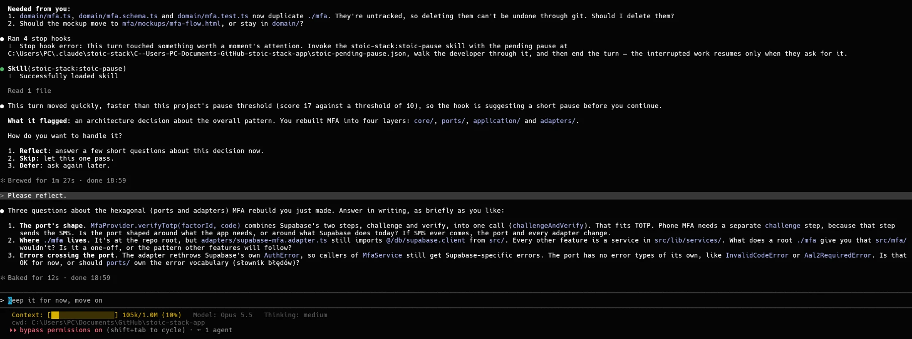
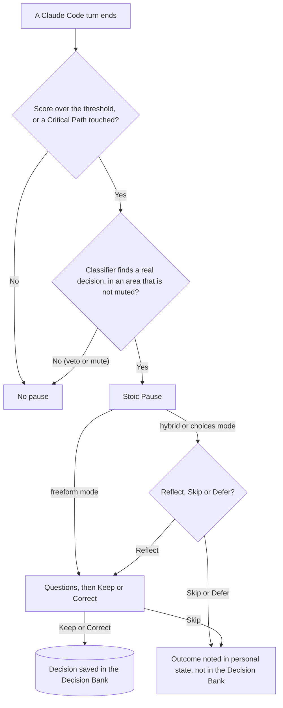
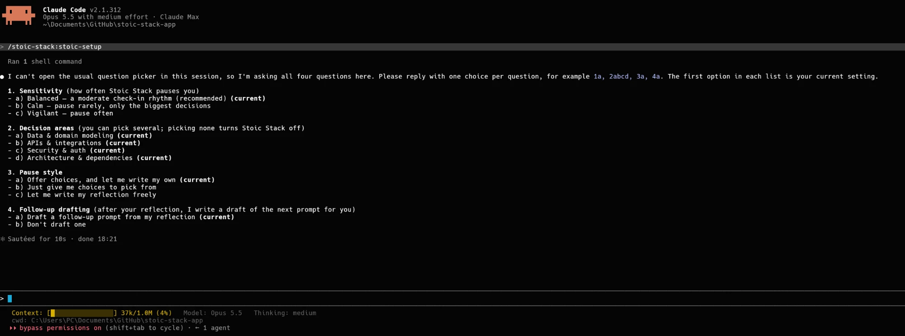
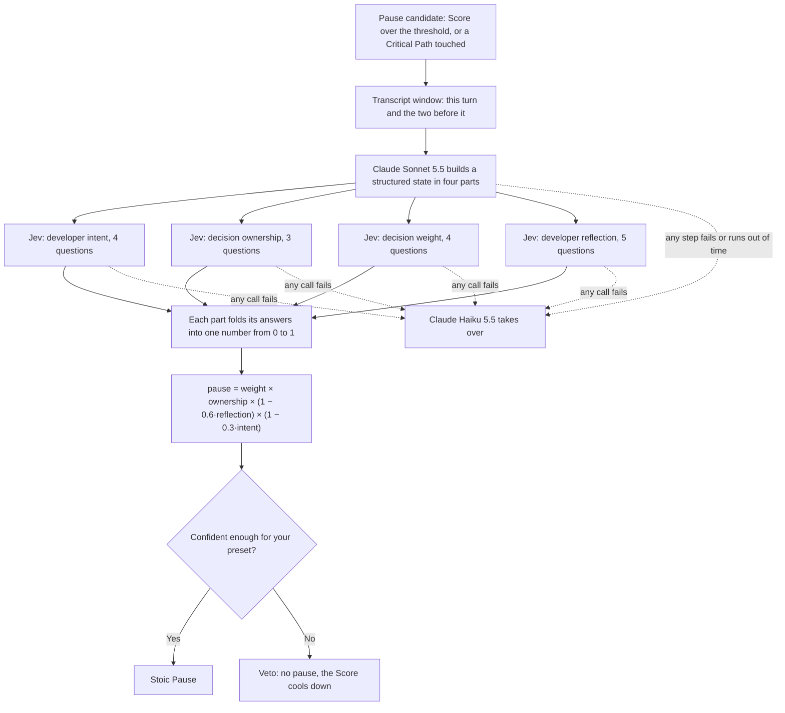

    

# Stoic Stack Plugin

A Claude Code plugin that runs in the background, watches your session and asks you to think a decision through before it slips by, so you stay the engineer who thinks, not the one who only accepts.

> _Think, and don't lose your resolve._

- **Local.** Runs through Claude Code hooks. No server, no telemetry, no npm dependencies.
- **Your account only.** The one call that leaves your machine goes through your own Claude Code login: Claude Haiku 5.5 reads the turn before a pause. Jev, an optional second provider, adds one dependency and is off by default.
- **Two steps.** One command to install, one `/stoic-stack:stoic-setup` to start.

## Why

Long sessions with an AI assistant push decisions onto the model. Prompts get shorter, changes keep landing, and after a while you no longer understand or own the choices made on your behalf. That is vibe coding: fast, but the decisions are no longer yours.

Stoic Stack builds tools that make the developer stronger. AI should add to your skill and judgement, not replace them. This plugin is the first, deliberately small step of that mission inside Claude Code. It is built for mid-level developers who know the fundamentals and want to stay in charge of their decisions while working with AI.

## Install

Requirements:

- Claude Code with plugin support.
- Node.js 22.13 or newer.
- `git` and `claude` on your `PATH`. They are not checked at install time.

Add the marketplace, then install the plugin:

```sh
claude plugin marketplace add marcindobrzynski-dev/stoic-stack-plugin
claude plugin install stoic-stack@stoic-stack
```

With Claude Code v2.1.292 or later, one command does both:

```sh
claude plugin install stoic-stack --marketplace marcindobrzynski-dev/stoic-stack-plugin
```

You can also do this from the `/plugin` menu inside Claude Code.

## Quick start

1. Run `/stoic-stack:stoic-setup` and answer its four questions.
2. Keep working as usual.
3. When a Stoic Pause appears, choose Reflect, Skip or Defer. If you picked free writing in setup, the questions come straight away.

Want to reflect right now? Run `/stoic-stack:stoic-reflect`.

## What it does

After every turn the plugin looks at what just happened. When it sees a decision slipping by, it stops the turn and offers a Stoic Pause. What counts as "slipping by" is described in [How it decides](#how-it-decides).

A pause first tells you what it noticed: the decision area, the reason and what triggered it. You choose **Reflect**, **Skip** or **Defer**. Skip lets this one pass. Defer asks again later. Reflect brings one to three short questions about the decision you just made. They are not generic: a subagent reads the files that changed, and every question names something concrete from your code. You answer in writing, then **Keep** the decision or **Correct** it. On Correct, when follow-up drafting is on, the plugin writes a prompt for the fix and you decide whether to send it.



Every kept or corrected decision lands in the Decision Bank, a private, git-ignored folder in your project, so you can read later what was decided and why.

You do not have to wait for the engine. Run `/stoic-stack:stoic-reflect` when you want to think a change through right away. It asks the same kind of questions and offers Keep or Correct.

## How it decides

The plugin keeps a Score for your project. Short prompts with no plan or constraints, and many edits landing fast, raise it. Prompts that dig in, ask questions and show that you want to understand what is happening lower it, and it slowly decays over time. When the Score crosses a threshold, the turn becomes a pause candidate.

Touching a Critical Path makes a pause candidate straight away. Critical Paths are the places where your important logic lives, for example the folder that handles authorization or the pricing rules of a shop. Those are only examples: you define your own in `.stoic/config.json`, and a few common ones come built in.

A pause candidate is not yet a pause. Before the plugin stops the turn, a Classifier reads what happened and may veto: no real decision was made, or it is not sure enough. By default this is one call to Claude Haiku 5.5 through your own Claude Code login, and setup does not ask about it because the default needs nothing from you. An experimental alternative, Jev, is described in [The Jev classifier](#the-jev-classifier-experimental).

The diagram shows the path from the end of a turn to a saved decision.



The full rules are in [the architecture documents](thoughts/shared/.project/architecture/).

## Setup and configuration

Run `/stoic-stack:stoic-setup` once per project. It asks four plain questions: how often to pause, which decision areas to watch, how you want to answer a pause, and whether to draft follow-up prompts.



The four built-in areas (data and domain, APIs and integrations, security and auth, architecture and dependencies) are a starting point, not a rule. Edit them, or ask Claude to pick the areas that fit your project.

Everything lives in `<project>/.stoic/config.json`. Setup writes only four fields: `preset`, `categories`, `pause_mode` and `followup_draft`. You edit the rest by hand. A wrong value is silently ignored, and the default is used.

| Field                             | What it does                                                    | Default                                                         |
| --------------------------------- | --------------------------------------------------------------- | --------------------------------------------------------------- |
| `enabled`                         | `false` turns every hook off.                                   | `true`                                                          |
| `preset`                          | How often pauses appear: `calm`, `balanced` or `vigilant`.      | `balanced`                                                      |
| `categories`                      | The areas a pause may cover.                                    | the 4 built-in areas                                            |
| `subcategories`                   | The labels in each area. `[]` turns an area off.                | the built-in labels                                             |
| `pause_mode`                      | How you answer a pause: `hybrid`, `choices` or `freeform`.      | `hybrid`                                                        |
| `followup_draft`                  | Whether a follow-up prompt is drafted from a recorded decision. | `true`                                                          |
| `critical_paths`                  | Path keywords that start a pause candidate straight away.       | `package.json`, `auth`, `migration`, `dockerfile`, `middleware` |
| `classifier_confidence_threshold` | How sure the Classifier must be before a pause goes ahead.      | built-in value                                                  |
| `classifier_model`                | The model the Classifier uses.                                  | Claude Haiku 5.5 (`claude-haiku-5-5`)                           |
| `max_questions`                   | The most questions one pause asks, from 1 to 3.                 | `3`                                                             |
| `advanced`                        | Overrides for single scoring knobs of the chosen preset.        | none                                                            |

`advanced` can override the threshold, decay, weights and mute windows; the full list is in [configuration.md](thoughts/shared/.project/architecture/configuration.md). The file is meant to be committed, so a team can share it.

## Make it yours

The defaults are a starting point. A pause never blocks you: Skip is always one answer away. If pauses come too often, the `calm` preset raises the bar so only the biggest decisions pause you. If they come too rarely, try `vigilant`. Then experiment: change the threshold, the decay or a single weight under `advanced`, and watch how the rhythm changes over a few sessions.

There is a second way to use the plugin. Each time you answer a pause, your reasoning enters the conversation, so Claude carries on with a clearer picture of what you want and why. The same answer is saved in the Decision Bank, where the thinking from earlier sessions waits for you when you come back. Used this way, the plugin is a lever for the quality of your context, not only a brake.

## The Jev classifier (experimental)

This section expands the Classifier step of the diagram in [How it decides](#how-it-decides). The default Classifier is one Claude Haiku 5.5 call. The alternative is Jev, a classifier run by TypeSafe, and it works differently.

The job is split in two. First Claude Sonnet 5.5 reads a short window of the transcript, this turn and the two before it, with your prompts, Claude's answers and the content of every edit, and turns it into a structured state in four parts: what you asked for, who made each decision and whether you were aware of it, how heavy the change is, and how much you reflected. Then each part goes to Jev with its own questions, 16 in total, and Jev returns a probability for each. The four parts fold into one pause probability:

```
pause = weight × ownership × (1 − 0.6 × reflection) × (1 − 0.3 × intent)
```

Heavy changes you did not own raise it. Your own reasoning and your own intent can only lower it. The preset sets the bar: 0.5 for `calm`, 0.35 for `balanced`, 0.25 for `vigilant`. In my own sessions the pauses chosen this way land better than with Haiku alone.



Jev runs only when all three conditions hold:

1. `classifier_model` in `<project>/.stoic/config.json` starts with `jev`. `jev-latest` is the id from the TypeSafe docs; the plugin only checks the prefix:

   ```json
   {
     "preset": "balanced",
     "classifier_model": "jev-latest"
   }
   ```

2. Your TypeSafe key sits in `<project>/.stoic/.env` (git-ignored). This file is the only place the key is read; a shell variable set with `export` is ignored:

   ```sh
   TYPESAFE_API_KEY=your-key-here
   ```

3. The TypeSafe SDK is installed by hand. A marketplace install does not do this for you. Run this in the plugin's root folder, which on a marketplace install is `~/.claude/plugins/cache/stoic-stack/stoic-stack/<version>/`:

   ```sh
   npm install --prefix experiments/jev
   ```

   This is the plugin's only dependency, and a plugin update replaces the folder, so repeat the step after updating.

If any condition is missing, or any step fails or runs out of time (38 seconds for the whole Jev path), the plugin silently falls back to Claude Haiku 5.5, whatever `classifier_model` says. A key on its own changes nothing.

What leaves your machine on this path is listed under [Privacy](#privacy).

**How to check that Jev really ran.** The fallback is silent: you see no message. Look at `~/.claude/stoic-stack/<project-slug>/jev-experiment.jsonl`, where `<project-slug>` is a file-safe name the plugin derives from the project folder's full path. The field `provider` is `jev` when Jev answered, and `headless_fallback` when Claude Haiku 5.5 took over. The field `status` gives the reason, for example `no_key` or `sdk_missing`.

Jev is still an experiment. To turn it off, set `classifier_model` back to `claude-haiku-5-5`, or remove the field.

## Privacy

What leaves your machine:

- **Default path.** The Classifier runs `claude -p` with Claude Haiku 5.5 (`claude-haiku-5-5`) on your own Claude Code login. The turn content goes to Anthropic, and nowhere else.
- **Opt-in Jev path.** This applies only when all conditions in [The Jev classifier](#the-jev-classifier-experimental) are met. The transcript window goes to Anthropic for the Claude Sonnet 5.5 (`claude-sonnet-5-5`) call that builds the session state. Each category's part of that state (your request, the described changes, the touched file paths) goes to TypeSafe, the company that runs Jev, as a second provider.

Nothing else leaves your machine. There is no server of ours and no telemetry.

- Engine state and logs live in `~/.claude/stoic-stack/`.
- The Decision Bank lives in `.stoic/decisions/` in your project (git-ignored).
- `.stoic/.env` (git-ignored) holds the optional Jev key.
- `.stoic/config.json` is meant to be committed, so a team can share it.

See also [SECURITY.md](SECURITY.md).

## Background

Stoic Stack began, and still lives, as a web app at [stoicstack.com](https://stoicstack.com): a free, Polish-language tool that applies Stoic practice to the everyday stress of a programmer's work. It has three parts. You can bring a stressful situation and let an AI help you see it from a distance, run your tasks tagged with the four Stoic virtues, and close the day with a short journal. The app taught me what works, but it was hard to make people keep coming back to a separate place. So I moved the idea to where developers already spend their day: Claude Code.

I have used and refined this plugin in my own work for several months. This is the first public version, built for one developer and one project at a time.

## License

MIT. See [LICENSE.md](LICENSE.md).
