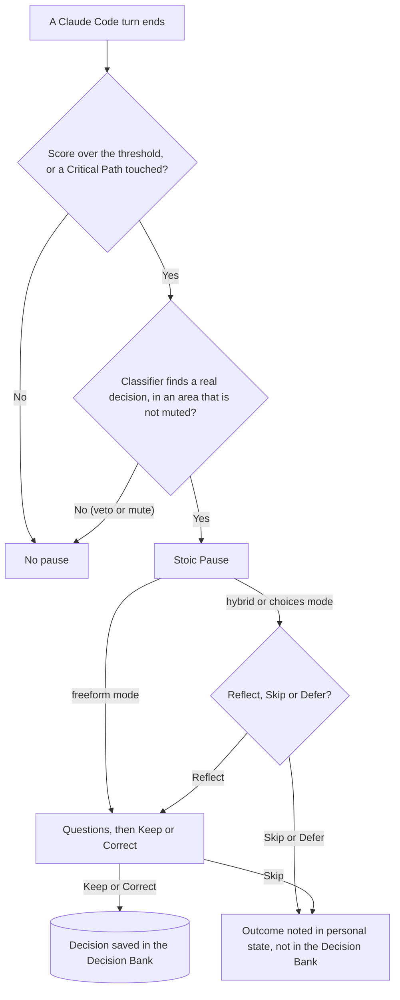

 [](LICENSE.md)   

# Stoic Stack Plugin

A background guardian for Claude Code that prompts you to reflect every so often, so you keep ownership of the decisions your AI is helping you make.

## Why it exists

Stoic Stack builds tools that make the developer stronger. AI should add to your skill and judgement, not wear it down. This plugin is the first, small step of that mission. It lives inside the tool you already use every day.

## Born from a personal need

Stoic Stack started as a web app at stoicstack.com. You could plan tasks, tie them to the four Stoic virtues, track progress, keep a journal, and ask an AI for a view from above. The app was interesting, but it was hard to make people stay in it. So I moved the idea to where developers already spend their day: Claude Code. The plugin watches the session, pauses at moments that matter so you can stop and think, and keeps your decisions in a Decision Bank. I have used and refined it in my own work for several months.

It is built for mid-level developers who know the fundamentals and want help staying in charge of their decisions while working with AI. This is the first stable version, not a perfect one: it sometimes pauses when it could skip, so you can always skip a pause.

## What it does

- **Stoic Pause.** At the end of a turn, the plugin may notice that you are drifting into autopilot. It then offers a short reflection. In the `hybrid` and `choices` modes you choose Reflect, Skip or Defer. In `freeform` mode there is no such choice: the pause goes straight to free writing.
- **Manual reflection.** Run `/stoic-stack:stoic-reflect` when you want to think a change through. You choose Keep or Correct.
- **Setup.** Run `/stoic-stack:stoic-setup` to pick how often pauses appear and which areas they cover.
- **Decision Bank.** Every decision you keep or correct is saved in your project, so you can read later what was decided and why. A skip is recorded too, but only as a count in your personal state outside the project, so repeated skips can quiet an area for a while.

## Install

Requirements:

- Claude Code with plugin support.
- Node.js 22.13 or newer.
- `git` and `claude` on your `PATH`. They are not checked at install time.

Add the marketplace, then install the plugin:

```sh
claude plugin marketplace add marcindobrzynski-dev/stoic-stack-plugin
claude plugin install stoic-stack@stoic-stack
```

With Claude Code v2.1.292 or later, one command does both:

```sh
claude plugin install stoic-stack --marketplace marcindobrzynski-dev/stoic-stack-plugin
```

## Quick start

1. Run `/stoic-stack:stoic-setup` and answer its few plain questions.
2. Keep working as usual.
3. When a Stoic Pause appears, choose Reflect, Skip or Defer. In `freeform` mode the pause goes straight to free writing instead.

Skip always works. The pause never blocks you.

## How it decides

The plugin keeps a Score for your project. The Score rises with each turn's signals, such as low prompt effort and many edits. It slowly decays over time. When it crosses a threshold, the turn becomes a pause candidate. Touching a Critical Path makes a pause candidate straight away. A Classifier call, Claude Haiku 5.5 (`claude-haiku-5-5`) by default, can then veto the pause when no real decision was made.

The diagram shows the path from the end of a turn to a saved decision.



The full rules are in [the architecture documents](thoughts/shared/.project/architecture/).

## Privacy

What leaves your machine:

- **Default path.** The Classifier runs `claude -p` with Claude Haiku 5.5 (`claude-haiku-5-5`) on your own Claude Code login. The turn content goes to Anthropic.
- **Opt-in Jev path.** This applies only when all Jev conditions are met. A Claude Sonnet 5.5 (`claude-sonnet-5-5`) call builds the session state. Each category's part of that state (your request, the described changes, the touched file paths) goes to TypeSafe, the company that runs Jev, as a second provider.

Nothing else leaves your machine. There is no server of ours and no telemetry.

- Engine state and logs live in `~/.claude/stoic-stack/`.
- The Decision Bank lives in `.stoic/decisions/` in your project (git-ignored).
- `.stoic/.env` (git-ignored) holds the optional Jev key.
- `.stoic/config.json` is meant to be committed, so a team can share it.

See also [SECURITY.md](SECURITY.md).

## Configuration

Settings live in `<project>/.stoic/config.json`. `/stoic-stack:stoic-setup` sets only four of them: `preset`, `categories`, `pause_mode` and `followup_draft`. You edit everything else by hand. A wrong value is silently ignored, and the default is used.

| Field                             | What it does                                                    | Default                                                         |
| --------------------------------- | --------------------------------------------------------------- | --------------------------------------------------------------- |
| `enabled`                         | `false` turns every hook off.                                   | `true`                                                          |
| `preset`                          | How often pauses appear.                                        | `balanced`                                                      |
| `categories`                      | The areas a pause may cover.                                    | the 4 built-in areas                                            |
| `subcategories`                   | The labels in each area. `[]` turns an area off.                | the built-in labels                                             |
| `pause_mode`                      | How you answer a pause: `hybrid`, `choices` or `freeform`.      | `hybrid`                                                        |
| `followup_draft`                  | Whether a follow-up prompt is drafted from a recorded decision. | `true`                                                          |
| `critical_paths`                  | Path keywords that start a pause candidate straight away.       | `package.json`, `auth`, `migration`, `dockerfile`, `middleware` |
| `classifier_confidence_threshold` | How sure the Classifier must be before a pause goes ahead.      | built-in value                                                  |
| `classifier_model`                | The model the Classifier uses.                                  | Claude Haiku 5.5 (`claude-haiku-5-5`)                           |
| `max_questions`                   | The most questions one pause asks, from 1 to 3.                 | `3`                                                             |
| `advanced`                        | Overrides for single scoring knobs (see below).                 | none                                                            |

Presets:

- `calm`: rare pauses.
- `balanced`: the default.
- `vigilant`: frequent pauses.

`advanced` overrides single scoring knobs of the chosen preset, such as the threshold, decay, weights and mute windows; the full list is in [configuration.md](thoughts/shared/.project/architecture/configuration.md).

The Jev classifier is described in [Experimental: Jev classifier](#experimental-jev-classifier).

## Experimental: Jev classifier

By default the plugin classifies turns with Claude Haiku 5.5 (`claude-haiku-5-5`) through your own Claude Code login. Jev runs only when all three conditions hold:

1. `classifier_model` in `.stoic/config.json` starts with `jev`, for example `jev-latest`.
2. `TYPESAFE_API_KEY` is set in `<project>/.stoic/.env`. This file is the only place the key is read. A shell environment variable (`export`) is ignored.
3. The TypeSafe SDK is installed by hand: run `npm install` in `experiments/jev` inside the plugin folder. A marketplace install does not do this for you.

If any condition is missing, or a Jev call fails, the plugin silently falls back to Claude Haiku 5.5 (`claude-haiku-5-5`), whatever `classifier_model` says. A key on its own changes nothing.

What Jev sends, and to whom: a Claude Sonnet 5.5 (`claude-sonnet-5-5`) call builds the session state. Each category's part of that state (your request, the described changes, the touched file paths) goes to TypeSafe, the company that runs Jev, as a second provider.

Jev is an experiment. To turn it off, set `classifier_model` back to `claude-haiku-5-5`, or remove the field.

**How to check that Jev really ran.** The fallback is silent: you see no message. Look at `~/.claude/stoic-stack/<project-slug>/jev-experiment.jsonl`, where `<project-slug>` is the project's slug, a file-safe name the plugin derives from the project folder's full path. The field `provider` is `jev` when Jev answered, and `headless_fallback` when Claude Haiku 5.5 (`claude-haiku-5-5`) took over. The field `status` gives the reason, for example `no_key` or `sdk_missing`.

## Status

This is a proof of concept, version 0.1.0, tested live by the author.

Not included yet:

- Team features.
- A dashboard.
- A quotes library.
- ML-based tuning.
- User profiles.

## License

MIT. See [LICENSE.md](LICENSE.md).
