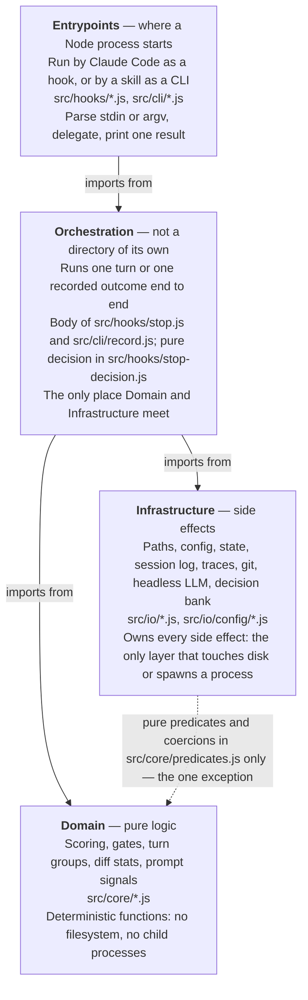

# Architecture for Stoic Stack Plugin PoC

**This document is a binding contract.** The implementation must match it; an
architectural change lands here, or in the companion it points to, before it
lands in code. This file holds what every reader needs — what the plugin is,
the rules every module obeys, and the layers. Everything else is one level
down in `architecture/`. The what and why live in `project-idea.md`; tooling
in `tech-stack.md`; engineering rules in `.agents/rules/` apply on top.

All code, identifiers, file names, and documentation are English.

## Overview

Stoic Stack is a Claude Code plugin: hooks plus skills, no server, no build
step. Five Claude Code hooks observe the session; a score engine decides when
the developer is drifting into autopilot; a Stoic Pause is then surfaced in
the main conversation as a short reflection moment (Reflect / Skip / Defer).
Answered reflections are persisted as decisions. A developer may also request
a pause without the engine, through the `stoic-reflect` skill.

Two LLM roles keep the cost split deliberate:

- **LLM #1 — classifier (veto gate).** A cheap headless `claude -p` call made
  from the Stop hook only when a pause is about to fire. It labels the turn
  with a decision category and can veto low-confidence or out-of-scope pauses.
- **LLM #2 — the main conversation.** Runs the `stoic-pause` or
  `stoic-reflect` skill: reads the pause context, asks the developer,
  generates 1–3 Socratic questions, and records the outcome.

## Design principles

Binding.

1. **Zero runtime dependencies.** Plugin code uses Node.js built-ins only
   (`fs`, `path`, `os`, `child_process`). `package.json` holds
   devDependencies exclusively (lint, format, test tooling).
2. **ESM everywhere.** `"type": "module"`, `import`/`export`, no build step —
   hooks run directly via `node`.
3. **Fail silent.** A hook must never break the user's session: any internal
   error is swallowed, one outcome line goes to the local or shared trace
   sink, and the hook exits successfully.
4. **State is written once per turn, at Stop — with one named exception.**
   Collection hooks only append events to a per-session log; the Stop hook is
   the single writer of decisions to fire. The score has exactly two writers,
   the Stop hook at a fire and `record.js` on a completed manual reflection,
   and both write it through one pure function in `src/core/scoring.js`. The
   mechanism is specified in
   [architecture/configuration.md §Score relief](architecture/configuration.md).
5. **Everything is local.** No telemetry, no network calls other than the
   headless `claude -p` classifier.

## Layered structure

Four layers with a strict downward dependency rule — a layer may only import
from layers below it. Each arrow reads "may import from":



Directory layout:

```
stoic-stack-plugin/
├─ .claude-plugin/plugin.json    # plugin manifest
├─ hooks/hooks.json              # hook registration -> node src/hooks/<x>.js
├─ skills/                       # LLM-facing content (see architecture/components.md)
├─ src/
│  ├─ hooks/                     # hook entrypoints (one per registered hook)
│  ├─ core/                      # pure domain logic, no I/O
│  ├─ io/                        # filesystem, config, headless LLM, git
│  └─ cli/                       # record.js, reflect.js, setup.js (shelled to by skills)
└─ test/                         # node:test suites, mirrors src/ — except test/loop/
```

The Domain layer is pure (deterministic functions, no filesystem, no child
processes) — this is what makes scoring unit-testable. The Infrastructure
layer owns every side effect. Orchestration (the body of the Stop hook and of
`record.js`) is the only place the two meet. One deliberate exception keeps
shared checks DRY: Infrastructure may import the pure validation predicates
and value coercions in `src/core/predicates.js` (a dependency-free Domain
leaf); the reverse direction — Domain importing anything from `src/io/*` —
remains forbidden.

## Companions

Each file below is binding in its own area. Read the one your change touches.

- [architecture/glossary.md](architecture/glossary.md) — the ubiquitous
  language. Read before naming anything; wins on conflict with every other
  document.
- [architecture/data-flow.md](architecture/data-flow.md) — the loop from
  prompt to recorded decision: the Stop order of operations, pause delivery,
  delegation, the self-instrumentation guards, and where every state file
  lives. Read before touching a hook, a CLI, or a path.
- [architecture/components.md](architecture/components.md) — every module
  under `src/` with its layer and responsibility, and the skills under
  `skills/`. Read before adding, moving, or renaming a module or a skill.
- [architecture/payloads.md](architecture/payloads.md) — hook inputs, event
  log shapes, state file schemas, the pause documents, and the CLI contracts.
  Read before changing anything a `// Contract:` header in code points at.
- [architecture/configuration.md](architecture/configuration.md) — config
  resolution, presets, every knob, the constants that are deliberately not
  knobs, and the score-relief mechanism. Read before touching `config.json`
  or `src/io/config/`.
- [architecture/testing.md](architecture/testing.md) — the three test tiers,
  the classifier seams, and the sandbox. Read before writing a test that
  spawns a process.
- [architecture/trade-offs.md](architecture/trade-offs.md) — deliberate
  compromises and the alternatives rejected. Read before "fixing" something
  that looks wrong on purpose.
