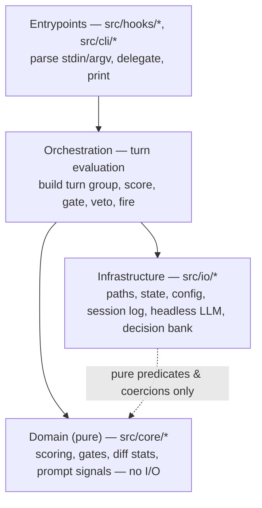
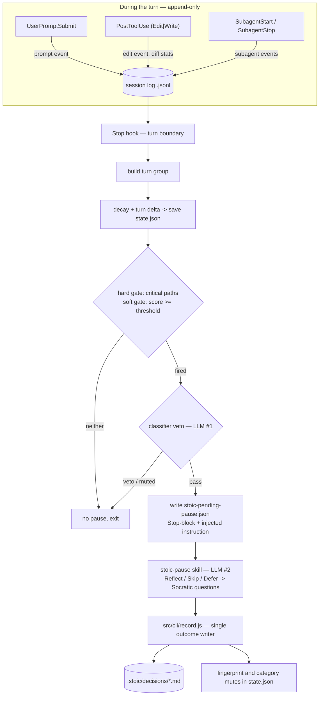

# Architecture for Stoic Stack Plugin PoC

> Site structure, layers, data flow, and component map — the how the code is organized. The what/why lives in project-idea.md and the tooling in tech-stack.md. Engineering rules in .agents/rules/ apply on top of this document.

All code, identifiers, file names, and documentation are English.

**This document is a binding contract.** The implementation must match it; an
architectural change lands in this document first, then in code. Detailed
references live next to it in `architecture/`:

- [architecture/2026-07-11_CONTEXT.md](architecture/2026-07-11_CONTEXT.md) — the ubiquitous language: canonical domain terms and their meanings.
- [architecture/configuration.md](architecture/configuration.md) — config concepts, presets, full knob list.
- [architecture/payloads.md](architecture/payloads.md) — hook payloads, event log shapes, state file schemas.
- [architecture/trade-offs.md](architecture/trade-offs.md) — known limitations and deliberate design trade-offs.

## Overview

Stoic Stack is a Claude Code plugin: hooks plus skills, no server, no build
step. Five Claude Code hooks observe the session; a score engine decides when
the developer is drifting into autopilot; a "stoic pause" is then surfaced in
the main conversation as a short reflection moment (Reflect / Skip / Defer).
Answered reflections are persisted as decisions.

Two LLM roles keep the cost split deliberate:

- **LLM #1 — classifier (veto gate).** A cheap headless `claude -p` call made
  from the Stop hook only when a pause is about to fire. It labels the turn
  with a decision category and can veto low-confidence or out-of-scope pauses.
- **LLM #2 — the main conversation.** Runs the `stoic-pause` skill: reads the
  pause context, asks the user, generates 1–3 Socratic questions, and records
  the outcome.

Design principles (binding):

1. **Zero runtime dependencies.** Plugin code uses Node.js built-ins only
   (`fs`, `path`, `os`, `child_process`). `package.json` holds
   devDependencies exclusively (lint, format, test tooling).
2. **ESM everywhere.** `"type": "module"`, `import`/`export`, no build step —
   hooks run directly via `node`.
3. **Fail silent.** A hook must never break the user's session: any internal
   error is swallowed into a debug sink and the hook exits successfully.
4. **State is written once per turn, at Stop — with one named exception.**
   Collection hooks only append events to a per-session log; the Stop hook is
   the single writer of decisions to fire. The score has exactly two writers,
   and both write it through one shared pure function in
   `src/core/scoring.js`: the Stop hook applies the cap when a pause fires,
   and `src/cli/record.js` applies the cap plus the reward when a manual
   reflection is completed. No other component may write the score.
5. **Everything is local.** No telemetry, no network calls other than the
   headless `claude -p` classifier.

## Layered structure

Four layers with a strict downward dependency rule — a layer may only import
from layers below it:



Directory layout:

```
stoic-stack-plugin/
├─ .claude-plugin/plugin.json    # plugin manifest
├─ hooks/hooks.json              # hook registration -> node src/hooks/<x>.js
├─ skills/                       # LLM-facing content (see Content layer)
├─ src/
│  ├─ hooks/                     # hook entrypoints (one per registered hook)
│  ├─ core/                      # pure domain logic, no I/O
│  ├─ io/                        # filesystem, config, headless LLM, git
│  └─ cli/                       # record.js, reflect.js, status.js (shelled to by skills)
└─ test/                         # node:test suites, mirrors src/ — except test/loop/ (see Testing)
```

The Domain layer is pure (deterministic functions, no filesystem, no child
processes) — this is what makes scoring unit-testable. The Infrastructure
layer owns every side effect. Orchestration (the body of the Stop hook and of
`record.js`) is the only place the two meet. One deliberate exception keeps
shared checks DRY: Infrastructure may import the pure validation predicates
and value coercions in `src/core/predicates.js` (a dependency-free Domain
leaf); the reverse
direction — Domain importing anything from `src/io/*` — remains forbidden.

## Data flow



Order of operations in the Stop hook (binding): read and truncate the session
log → build the turn group → decay score by half-life, add turn delta, floor
at zero → **save state before gating** → evaluate hard gate (critical-path
match, bypasses score) and soft gate (score ≥ threshold) → on a fired gate,
run the classifier and apply its veto → check mutes (category and touched-file
fingerprint) → fire: apply the cooldown cap, write
`stoic-pending-pause.json`, emit the Stop-block.

**One pressure-relief mechanism, applied at two moments.** A pause relieves
score pressure through one shared pure function in `src/core/scoring.js`, and
nowhere else. The first moment is a fire: the Stop hook applies
`relievedScore`, capping the persisted score — `score = min(score, threshold ×
cooldown_ratio)` — never raising it. A low-score critical-path fire therefore
leaves the score untouched, a just-over-threshold fire cannot re-fire on the
next turn, and a far-over-threshold streak drains in one step. The pause
document's `score` field carries the fire-time value from _before_ the cap, so
the skill and later analytics see why the pause fired.

The second moment is a completed manual reflection: `record.js` applies
`rewardedScore` — the same cap, then a further discount by
`MANUAL_RELIEF_FACTOR` — because a reflection the developer chose is worth
more than one the engine imposed, and because a cap alone would reward a
developer who reflects _before_ drifting with nothing. It is the reward for
thinking, not for asking: it applies only on `keep` or `correct` under a
`manual` trigger, never on `skip` or `defer`, and never on the automatic path,
which its own fire already relieved. Those two writers are exhaustive — no
other component may write the score (see
[trade-off 14](architecture/trade-offs.md)).

`Stop` is registered with a **90-second timeout** — the only hook that carries
one, since the other four only append a line and return. The headroom is
reserved for the classifier's headless `claude -p` call, which runs inside this
same invocation once Epic 2 lands.

### Pause delivery contract

Hooks cannot render UI, so a pause is delivered as a deliberate workaround:
the Stop hook returns `{"decision": "block", "reason": <instruction>}`, where
the instruction tells the main conversation to invoke the `stoic-pause` skill.
The skill reads its context from `stoic-pending-pause.json` and reports the outcome
by shelling to `src/cli/record.js`, which deletes the file on success.

The injection text, the `stoic-pending-pause.json` and `stoic-manual-pause.json`
schemas, and the `record.js` and `reflect.js` CLI interfaces are
**load-bearing**: a change to any of them must update the Stop hook, the
`stoic-pause` and `stoic-reflect` skills, and the integration tests together.
Schemas live in [architecture/payloads.md](architecture/payloads.md).

A developer may also open a pause without the engine: the `stoic-reflect`
skill shells to `src/cli/reflect.js`, which measures `git diff HEAD` and writes
`stoic-manual-pause.json` — a second document under the same schema, never the
pending one. The conversation that follows is the same, and it reports through
the same `record.js`.

### Delegation

Edits made by sub-agents are attributed per event: a `PostToolUse` payload
carrying `agent_id` marks the edit event `delegated: true` (plus
`agent_type`). Delegated edits weigh into the score at a **reduced weight**
(the `delegated_discount` knob) — refining the earlier "like any other
autopilot signal" decision: autopilot is a property of the user's input, not
of the machine's output, and a deliberate, planned fan-out is normal
engineering (see the [domain glossary](architecture/2026-07-11_CONTEXT.md)).
A low-effort prompt that fans out agents still scores, through the
prompt-effort signal plus the discounted delegated volume. There is no live
sub-agent counter and no prompt-suppression window — that sandbox mechanism
was dropped as too stateful for its value (see trade-offs.md). Consequence:
edits from background delegation that land after the parent turn's Stop are
scored one turn late (see trade-offs.md).

### Self-instrumentation guards

The plugin must never score its own machinery. These guards are correctness
conditions, not optimizations — the easiest place to introduce a regression:

- `STOIC_INTERNAL=1` is set in the classifier's headless child environment;
  every hook exits immediately when it is present.
- Edit events under `.stoic/` or outside the project cwd are dropped.
- Prompts starting with `/stoic-stack` are ignored by UserPromptSubmit.
- The Stop invocation that follows a pause (`stop_hook_active`) truncates the
  session log and exits, so pause machinery never feeds the next score.

### State locations

| What                                                                                                                                                | Where                                   | Git policy                                  |
| --------------------------------------------------------------------------------------------------------------------------------------------------- | --------------------------------------- | ------------------------------------------- |
| Engine state: `state.json` (score, mutes, streaks), per-session event log, `stoic-pending-pause.json`, `stoic-manual-pause.json`, trace/debug sinks | `~/.claude/stoic-stack/<project-slug>/` | outside the repo                            |
| User config: `config.json`                                                                                                                          | `<project>/.stoic/`                     | committed (team-shareable)                  |
| Decision bank: `YYYY-MM-DD_<branch>.md`                                                                                                             | `<project>/.stoic/decisions/`           | in repo, gitignored (written by the plugin) |

All engine writes are atomic (tmp file + rename). Schemas are specified in
[architecture/payloads.md](architecture/payloads.md); config in
[architecture/configuration.md](architecture/configuration.md).

## Component map

| Module                                            | Layer                       | Responsibility                                                                                                                                                                                                                                                                      |
| ------------------------------------------------- | --------------------------- | ----------------------------------------------------------------------------------------------------------------------------------------------------------------------------------------------------------------------------------------------------------------------------------- |
| `src/hooks/hook-runtime.js`                       | Entrypoints (shared leaf)   | Shared leaf for `capture.js` and `stop.js` (which never import each other): read and validate the stdin payload, one-line a thrown value.                                                                                                                                           |
| `src/hooks/capture.js`                            | Entrypoints (shared)        | The frame every capture hook runs inside: `STOIC_INTERNAL` guard, stdin parse, enabled check, append, one trace line, swallow everything.                                                                                                                                           |
| `src/hooks/user-prompt-submit.js`                 | Entrypoints                 | Append `prompt` event (truncated text + effort computed at write time); skip own prompts; log harness-injected notifications as `neutralized`.                                                                                                                                      |
| `src/hooks/post-tool-use.js`                      | Entrypoints                 | Append `edit` event with diff stats and delegation attribution.                                                                                                                                                                                                                     |
| `src/hooks/subagent-start.js`, `subagent-stop.js` | Entrypoints                 | Append sub-agent lifecycle events.                                                                                                                                                                                                                                                  |
| `src/hooks/stop.js`                               | Entrypoints + Orchestration | The turn-boundary brain: score, gate, veto, fire the pause.                                                                                                                                                                                                                         |
| `src/cli/record.js`                               | Entrypoints + Orchestration | Single writer for pause outcomes (keep / correct / skip / defer), for both documents. Also the second of the score's two writers: applies `rewardedScore` when a `manual` pause is kept or corrected, and touches the score under no other condition.                               |
| `src/cli/reflect.js`                              | Entrypoints + Orchestration | Single writer for the manual pause document (`stoic-manual-pause.json`): measures `git diff HEAD` into the turn-group fields and writes nothing else — no score, no mutes, no bank entry, no engine state.                                                                          |
| `src/cli/setup.js`                                | Entrypoints + Orchestration | Single writer for guided setup: inspect current choices (`--current`), or validate and apply a complete set (`--apply`).                                                                                                                                                            |
| `src/cli/status.js`                               | Entrypoints                 | Read-only observability (`--json`) plus preset switching (writes the personal `state.preset` override).                                                                                                                                                                             |
| `src/core/scoring.js`                             | Domain                      | Score decay, turn delta (incl. the delegated-edit discount), and the arithmetic of relief both score writers share: `relievedScore` (the fire-time cap) and `rewardedScore` (that cap, then the manual-reflection reward).                                                          |
| `src/core/prompts.js`                             | Domain                      | Prompt-effort heuristic, harness-injection (task-notification) detection.                                                                                                                                                                                                           |
| `src/core/group.js`                               | Domain                      | Turn-group builder: session events → turn summary (the `group` in `stoic-pending-pause.json`).                                                                                                                                                                                      |
| `src/core/gates.js`                               | Domain                      | Critical-path matching, mute evaluation and pruning.                                                                                                                                                                                                                                |
| `src/core/diffstats.js`                           | Domain                      | Edit-size extraction from tool payloads.                                                                                                                                                                                                                                            |
| `src/core/predicates.js`                          | Domain (leaf)               | Shared pure validation predicates and value coercions, importable from every layer.                                                                                                                                                                                                 |
| `src/io/paths.js`                                 | Infrastructure              | All path resolution — pure; directories come into existence only through writers.                                                                                                                                                                                                   |
| `src/io/trace.js`                                 | Infrastructure              | Fail-silent bounded trace sink: one outcome line per hook invocation, size-capped with a single rotation.                                                                                                                                                                           |
| `src/io/json-file.js`                             | Infrastructure              | Fail-safe JSON document helpers: status-reporting reads, atomic tmp+rename writes (used by config and state).                                                                                                                                                                       |
| `src/io/state.js`                                 | Infrastructure              | Atomic load/save of `state.json`.                                                                                                                                                                                                                                                   |
| `src/io/config/config.js`                         | Infrastructure              | Config defaults, presets, category taxonomy, knob resolution, the guided-choice model, atomic save.                                                                                                                                                                                 |
| `src/io/config/manual-reflection.js`              | Infrastructure              | The small config subset the manual-reflection path needs (`pause_mode`, `max_questions`, `followup_draft`, `threshold`, `cooldown_ratio`, `manual_relief_factor`), plus `MANUAL_RELIEF_FACTOR` — a mechanism constant, deliberately not a knob. Imports one-way from `./config.js`. |
| `src/io/git-diff.js`                              | Infrastructure              | Working-tree reader: `git diff HEAD --numstat` (staged and unstaged, committed work excluded) into diff-stat fields, through an injectable spawn. Every failure degrades to a clean tree; never throws.                                                                             |
| `src/io/session-log.js`                           | Infrastructure              | Append/read/truncate the per-session event log.                                                                                                                                                                                                                                     |
| `src/io/headless.js`                              | Infrastructure              | Cross-platform `claude -p` runner; returns a clean "unavailable" result on any failure, never throwing.                                                                                                                                                                             |
| `src/io/classifier.js`                            | Infrastructure              | LLM #1 prompt build, verdict validation, category resolution, and the fail-safe `classify` seam evaluating the veto reasons in contract order.                                                                                                                                      |
| `src/io/bank.js`                                  | Infrastructure              | Decision-bank markdown writer (enforces `.gitignore`) and aggregate reader.                                                                                                                                                                                                         |

## Content layer

All LLM-facing content is markdown under `skills/` — no `commands/` directory
(Claude Code merged commands into skills; skills are the recommended layout
for new plugins). Content is prompts, not code; it talks to code only through
two seams: reading a pause document (`stoic-pending-pause.json` or
`stoic-manual-pause.json`) and shelling to `src/cli/*.js`.

| Skill                   | Invocation                                   | Purpose                                                                                                                           |
| ----------------------- | -------------------------------------------- | --------------------------------------------------------------------------------------------------------------------------------- |
| `skills/stoic-setup/`   | user only (`disable-model-invocation: true`) | ≤4 plain-language questions → shells to `setup.js`; never constructs config itself.                                               |
| `skills/status/`        | user only (`disable-model-invocation: true`) | Show score, recent decisions, heartbeat — via `status.js --json`.                                                                 |
| `skills/stoic-reflect/` | user only (`disable-model-invocation: true`) | A reflection on demand: shells to `reflect.js` for the material, asks in the in-progress tense, resolves to Keep or Correct only. |
| `skills/stoic-pause/`   | model and user (no invocation key)           | The pause cascade: gate question → read touched files → 1–3 Socratic questions → record outcome.                                  |

Keep `SKILL.md` bodies lean; only descriptions are always in context, bodies
load on invocation.

`stoic-pause` is the one skill both the model and the user can invoke. The
model path is the Stop-block instruction and is what the pause is for; the user
path costs nothing extra — a description that lets the hook fire the skill
already lets the developer type it — and it is the only way to finish a pause
that was interrupted, since the pending document outlives the turn and nothing
else consumes it. Typing the skill never creates a pause: with no pending
document it says one line and ends the turn.

Reflection on demand is the separate `stoic-reflect` skill, and it ships. It is
the one skill the model may _not_ invoke: the premise of its score reward is
that the developer chose to reflect, so a model-triggered invocation would
counterfeit exactly that. It has its own writer, `src/cli/reflect.js`, and its
own document, `stoic-manual-pause.json` — a second file rather than a `manual`
value inside the pending one, so that requesting a reflection can never
overwrite an automatic pause the developer had interrupted.

## Testing

`node:test` (built-in runner, zero extra dependencies), run via `npm test`.
Three tiers under `test/`. The first two mirror `src/` one directory for one,
each file holding a single module under test; the third deliberately does not:

- **Unit** — the Domain layer (`src/core/*`): pure functions tested
  exhaustively, including scoring edge cases and gate/mute logic.
- **Integration** — real hook scripts executed as child processes against
  throwaway temp projects, asserting the full pipeline moves
  (prompt → edit → Stop → `state.json` → pause fired). No network: the
  classifier and headless runner are faked through a programmatic spawn
  seam. `src/io/headless.js` accepts an optional spawn implementation
  (`options.spawn`) whose production default is the real platform cascade;
  tests pass a seam that substitutes only the executable — a stub Node
  script under `test/fixtures/` standing in for the Claude CLI — so the real
  stdin delivery, child environment, timeout, and output cap are still
  exercised. `src/io/classifier.js` carries the same seam one level up:
  `classify` accepts an optional `options.runner` defaulting to the real
  headless module, so a suite that needs a fixed verdict substitutes the
  whole call rather than the executable.

  Neither seam crosses a process boundary. A hook driven as a child process
  cannot be handed a runner, so the two needs — exercising the real
  entrypoint, and fixing the verdict — are met at two levels rather than
  one:

  - **In-process** — the pure decision function a hook exposes is called
    directly, with `options.runner` returning a fixed verdict. This level
    covers the combinatorial surface exhaustively (every veto reason, every
    mute state, score arithmetic) and spawns nothing.
  - **Child process** — the real entrypoint runs under `createSandbox`, with
    the stub CLI placed on the child's `PATH` under the name the runner
    resolves (`claude.cmd` on Windows, matching the production cascade).
    Nothing in the production path changes; only what the operating system
    finds under that name does. This level asserts what is observable only
    from outside: files written, stdout, exit code, and state carried across
    two consecutive runs.

  The child-process level therefore does spawn a process standing in for the
  CLI. That is deliberate and bounded — see [trade-off
  12](architecture/trade-offs.md) — and carries none of the properties the
  no-network rule protects: no network, no model, no cost, and a fixed
  answer.

  No environment variable can activate any of these seams, so a test hook can
  never alter a real user's session.

- **Loop** — `test/loop/`: composition suites that chain real processes —
  the Stop hook, `reflect.js`, `record.js` — over a real temporary project and
  have no single module under test, which is why they sit outside the mirror.
  `automatic.test.js` drives the engine-fired pause through every Outcome;
  `manual.test.js` drives the developer-requested reflection over a real git
  repository, including its reward and its coexistence with a pending
  automatic pause.

Child processes run against an isolated temporary project and temporary home
(`HOME`/`USERPROFILE` overrides), so suites can never touch a contributor's
real project or personal state. Test fixtures under `test/fixtures/` are
inert unless the harness sets `STOIC_TEST_SANDBOX=1` — a safety interlock,
not a runtime seam.

The load-bearing contracts (pause delivery, `record.js` CLI, payload schemas)
each have a dedicated integration test; changing a contract without updating
its test must fail CI.
