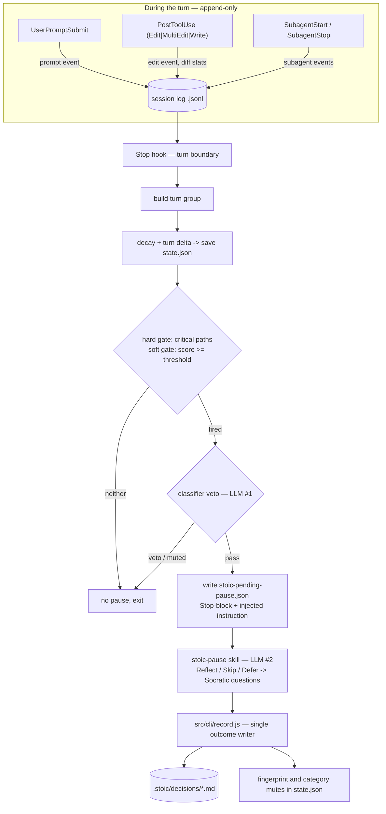

# Data flow

> Companion to [../architecture.md](../architecture.md). What happens between
> a prompt and a recorded decision: the collection hooks, the turn boundary,
> the gates, the pause delivery, and where every piece of state lives. Schemas
> are in [payloads.md](payloads.md); knobs in
> [configuration.md](configuration.md).

## The loop

## Stop order of operations

Binding. The Stop hook runs these steps in this order:

1. Read and truncate the session log.
2. Build the turn group.
3. Decay the score by half-life, add the turn delta, floor at zero.
4. **Save state before gating.**
5. Evaluate the hard gate (critical-path match, bypasses the score) and the
   soft gate (score ≥ threshold). `critical_path` wins when both apply.
6. On a fired gate, run the classifier and apply its veto, in the frozen
   reason order of [payloads.md §Classifier verdict](payloads.md).
7. Check mutes — category, then touched-file fingerprint. The classifier runs
   first because a mute is keyed by the category it produces (see
   [trade-off 13](trade-offs.md)).
8. Fire: apply the cooldown cap to the persisted score, write
   `stoic-pending-pause.json`, emit the Stop-block.

A continuation Stop (`stop_hook_active`) truncates the session log without
scoring and counts what it drops, so pause machinery never feeds the next
score.

The score has exactly two writers — this hook at a fire, and `record.js` on a
completed manual reflection — and both go through one pure function in
`src/core/scoring.js`. The mechanism, its cap, and its reward are specified
once, in [configuration.md §Score relief](configuration.md); the decision to
allow the second writer is [trade-off 14](trade-offs.md).

`Stop` is registered with a **90-second timeout** — the only hook that carries
one, since the other four only append a line and return. The headroom is
reserved for the classifier's headless `claude -p` call, which runs inside
this same invocation with its own 45-second budget.

## Pause delivery

Hooks cannot render UI, so a pause is delivered as a deliberate workaround
([trade-off 1](trade-offs.md)): the Stop hook returns
`{"decision": "block", "reason": <instruction>}`, where the instruction tells
the main conversation to invoke the `stoic-pause` skill. The skill reads its
context from `stoic-pending-pause.json` and reports the outcome by shelling to
`src/cli/record.js`, which deletes the file on success.

The injection text, the `stoic-pending-pause.json` and `stoic-manual-pause.json`
schemas, and the `record.js` and `reflect.js` CLI interfaces are
**load-bearing**: a change to any of them must update the Stop hook, the
`stoic-pause` and `stoic-reflect` skills, and the integration tests together.
The four parts of the contract are specified in [payloads.md](payloads.md).

A developer may also open a pause without the engine: the `stoic-reflect`
skill shells to `src/cli/reflect.js`, which measures `git diff HEAD` and writes
`stoic-manual-pause.json` — a second document under the same schema, never the
pending one, so that requesting a reflection can never overwrite an automatic
pause the developer had interrupted. The conversation that follows is the
same, and it reports through the same `record.js`.

## Delegation

Edits made by sub-agents are attributed per event: a `PostToolUse` payload
carrying `agent_id` marks the edit event `delegated: true` (plus
`agent_type`). Delegated edits weigh into the score through the
`delegated_discount` knob. The preset defaults are 0.5 on `calm` and 1 (full
cost) on `balanced` and `vigilant`. That is a default only:
`advanced.delegated_discount` replaces it on any preset, so a project can
discount on `balanced` or stop discounting on `calm`. Autopilot is a property
of the developer's input, not of the machine's output, and a deliberate,
planned fan-out is normal engineering (see [Autopilot](glossary.md)). A
low-effort prompt that fans out agents still scores, through the prompt-effort
signal plus delegated volume at whatever discount is in force. There is no
live sub-agent counter and no prompt-suppression
window ([trade-off 4](trade-offs.md)). Edits from background delegation that
land after the parent turn's Stop are scored one turn late
([trade-off 8](trade-offs.md)).

## Self-instrumentation guards

The plugin must never score its own machinery. These guards are correctness
conditions, not optimizations — the easiest place to introduce a regression:

- `STOIC_INTERNAL=1` is set in the classifier's headless child environment;
  every hook exits immediately when it is present.
- Edit events under `.stoic/` or outside the Project Root are dropped.
- Prompts starting with `/stoic-stack` are ignored by UserPromptSubmit.
- The continuation Stop truncates the session log and exits, as above.

## State locations

`<project>` below is the Project Root (see [glossary.md](glossary.md)): the
directory `src/io/project-root.js` resolves for every entrypoint, not the
directory the session happened to start in. `<project-slug>` is its slug from
`paths.js`. When no root can be resolved, the only thing written is one line
in the shared trace.

| What                                                                                                                                                                                                                                                                                                   | Where                                   | Git policy                                  |
| ------------------------------------------------------------------------------------------------------------------------------------------------------------------------------------------------------------------------------------------------------------------------------------------------------ | --------------------------------------- | ------------------------------------------- |
| Engine state: `state.json` (score, mutes, streaks), per-session event log, `stoic-pending-pause.json`, `stoic-manual-pause.json`, `local-trace.jsonl` (plus, on the structured-state Jev experiment branch, `jev-experiment.jsonl`, `jev-experiment/<ts>.json`, and `jev-summaries/<session_id>.json`) | `~/.claude/stoic-stack/<project-slug>/` | outside the repo                            |
| Shared trace: `shared-trace.jsonl`, the `no_project_root` and `error` outcomes of an invocation that could not name its project                                                                                                                                                                        | `~/.claude/stoic-stack/`                | outside the repo                            |
| User config: `config.json`                                                                                                                                                                                                                                                                             | `<project>/.stoic/`                     | committed (team-shareable)                  |
| Decision bank: `YYYY-MM-DD_<branch>.md`                                                                                                                                                                                                                                                                | `<project>/.stoic/decisions/`           | in repo, gitignored (written by the plugin) |

All engine writes are atomic (tmp file + rename).
